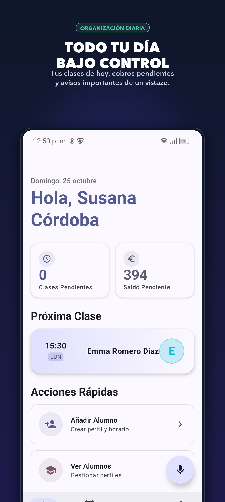
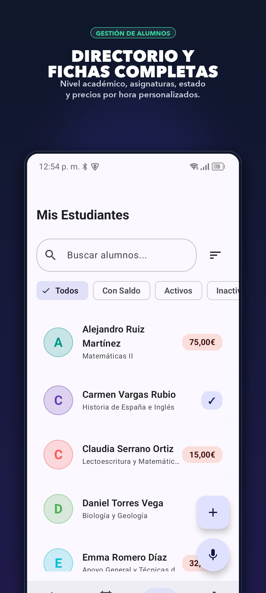
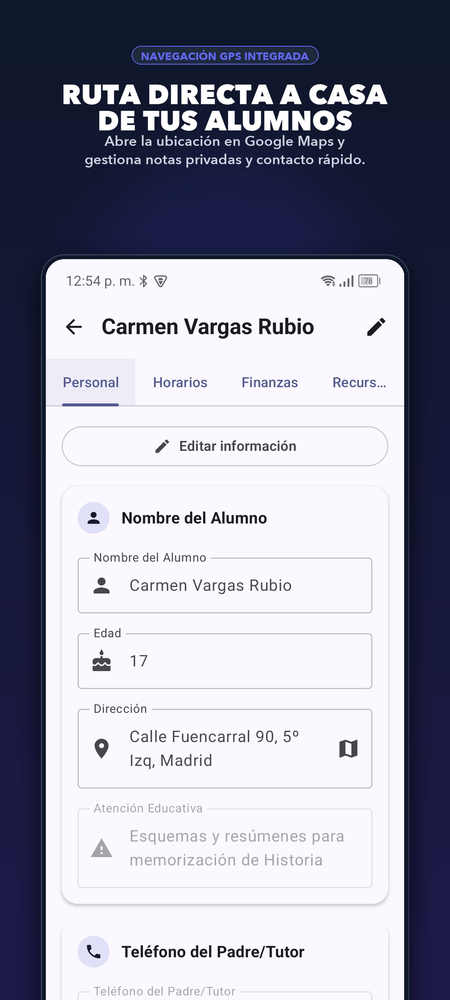
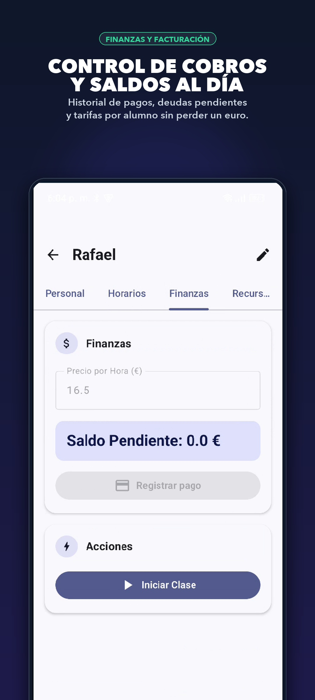
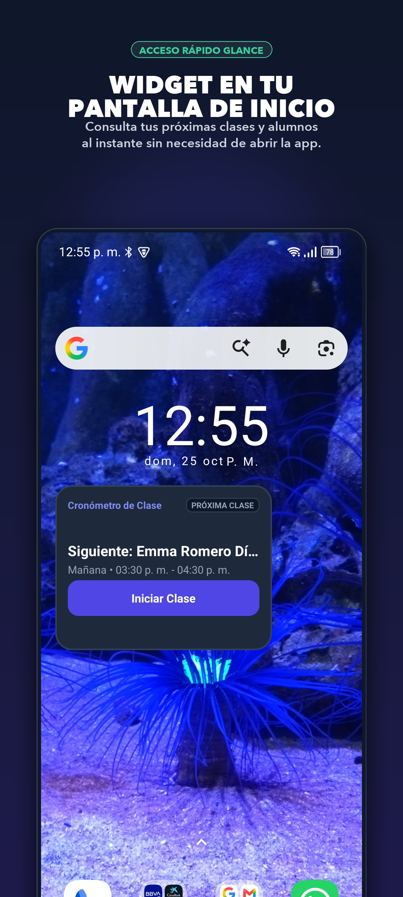
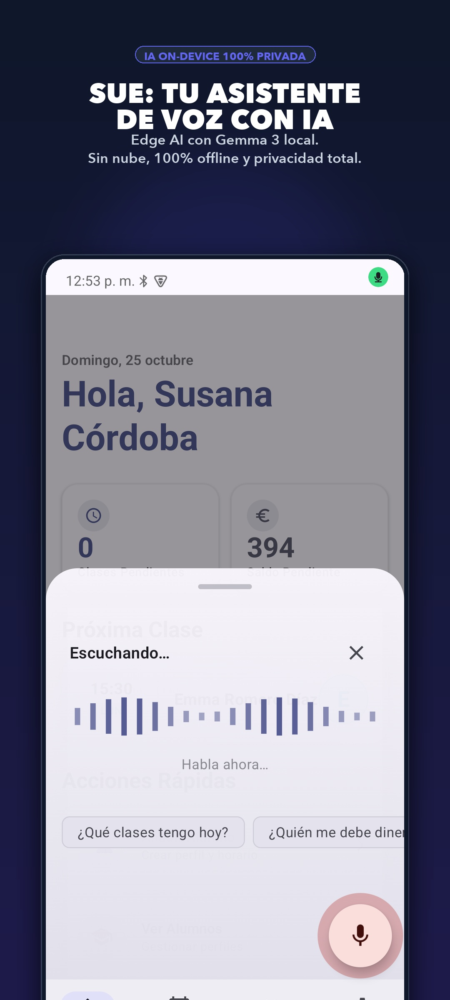
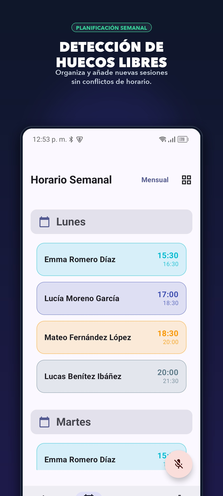
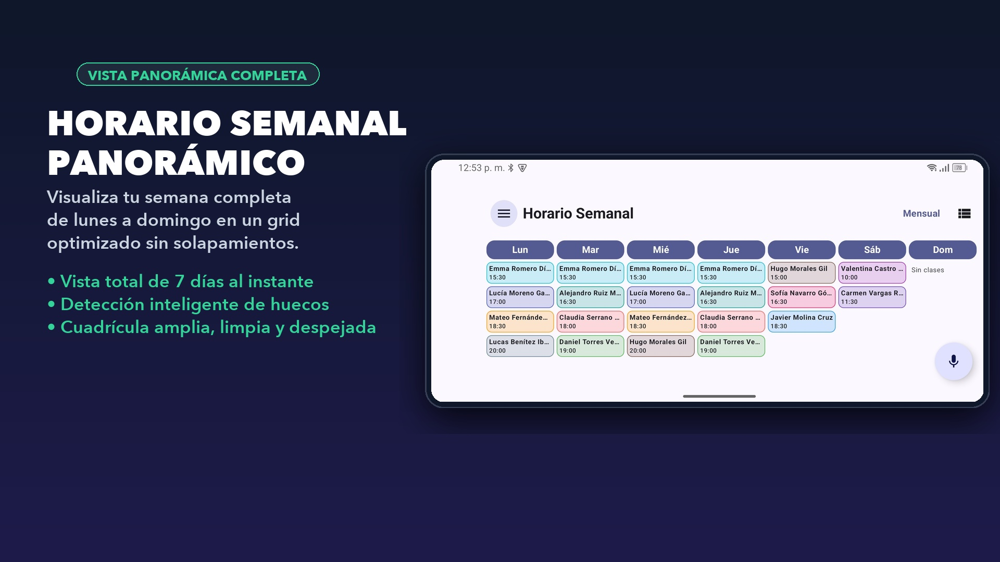

<p align="center">
  
</p>

<h1 align="center">HomeTutorPro</h1>

<p align="center">
  <a href="#"></a>
  <a href="#"></a>
  <a href="#"></a>
</p>

<p align="center">
  <strong>Productividad real para profesores a domicilio</strong><br>
  Aplicación mobile construida con arquitectura moderna, foco en mantenibilidad y casos de uso reales.
</p>

---

## ✨ Características Principales

* **👥 Gestión de Alumnos:** Fichas completas con nivel académico, materias, tarifas personalizadas y notas privadas.
* **📅 Agenda y Horarios:** Visualización de horario semanal con detección inteligente de huecos libres y conflictos.
* **🧭 Navegación GPS Integrada:** Acceso directo a Google Maps para trazar la ruta a casa del alumno en un toque.
* **💰 Finanzas y Cobros:** Historial de clases, control de saldo pendiente y cobros al día por estudiante.
* **📱 Widget Android (Glance):** Consulta tu próxima clase e inicia el seguimiento directamente desde tu pantalla de inicio.
* **🤖 SUE — Asistente IA On-Device:** Asistente de voz local con Edge AI, 100% privado y sin necesidad de conexión a internet.
* **📴 Offline-first & Sincronización:** Operatividad total sin conexión mediante base de datos Room local y sincronización en segundo plano con Firebase.

---

## 📸 Capturas de Pantalla

### 📱 Funcionalidades Principales

| Dashboard Principal | Directorio de Alumnos | Perfil Alumno & Ruta GPS |
| :---: | :---: | :---: |
|  |  |  |

| Control de Cobros y Saldo | Widget Glance de Inicio | Asistente de Voz IA (SUE) |
| :---: | :---: | :---: |
|  |  |  |

### 🗓️ Gestión de Horarios: Vistas Vertical y Panorámica

| Horario Vertical (Detección de Huecos) | Vista Panorámica (Semana Completa) |
| :---: | :---: |
|  |  |

---

## 🏗️ Arquitectura

El proyecto implementa **Clean Architecture con MVVM** y **Unidirectional Data Flow (UDF)**, diseñado siguiendo los principios SOLID y directrices oficiales de Android:

```text
com.devsusana.hometutorpro
│
├── domain/                      # Lógica de negocio pura (independiente de Android/UI)
│   ├── entities/                # Modelos de datos inmutables del dominio
│   ├── repository/              # Contratos e interfaces de repositorios
│   └── usecases/                # Casos de uso con operador invoke()
│
├── data/                        # Recuperación y persistencia de datos
│   ├── local/                   # Room Database, DAOs y entidades locales
│   ├── remote/                  # Firebase Firestore y servicios remotos
│   ├── repository/              # Implementaciones de repositorios del dominio
│   ├── sync/                    # Workers y schedulers de sincronización en segundo plano
│   └── mappers/                 # Transformadores entre modelos de datos y entidades
│
├── presentation/                # Interfaz de usuario declarativa con Jetpack Compose
│   ├── dashboard/               # Pantalla principal y resumen diario
│   ├── weekly_schedule/         # Grilla y agenda semanal de clases
│   ├── student_list/            # Listado, búsqueda y filtrado de estudiantes
│   ├── student_detail/          # Ficha completa, finanzas y notas del alumno
│   ├── sue/                     # Interfaz de voz del asistente IA on-device
│   ├── widget/                  # Widgets de pantalla de inicio con Jetpack Glance
│   └── components/              # Componentes de UI reutilizables
│
├── di/                          # Inyección de dependencias modular con Hilt
├── navigation/                  # Navegación Type-Safe con Compose Navigation
└── core/                        # Utilidades comunes y constantes de la aplicación
```

### Capas

* **UI:** Jetpack Compose + ViewModels
* **Domain:** Casos de uso y reglas de negocio
* **Data:** Repositorios, fuentes de datos y persistencia

Cada feature está verticalmente segmentada para:
- Máxima testabilidad
- Aislamiento
- Evolución independiente

---

## 🧩 Tech Stack

* **Lenguaje:** Kotlin
* **UI:** Jetpack Compose
* **Arquitectura:** Clean Architecture + MVVM
* **Async:** Coroutines + Flow
* **DI:** Hilt
* **Persistencia:** Room / DataStore
* **Navegación:** Compose Navigation
* **Testing:** JUnit, MockK, Turbine
* **Build:** Gradle (Version Catalogs + Convention Plugins)

---

## 🚀 Instalación

1. Clona el repositorio.
2. Abre el proyecto en Android Studio.
3. Sincroniza Gradle.
4. Ejecuta la variante `debug` en emulador o dispositivo físico.

---

## 🛣 Roadmap

### Fase 1 — Core ✅
- [x] Gestión integral de alumnos y fichas académicas
- [x] Agenda diaria y grilla de horario semanal
- [x] Persistencia local offline-first con Room Database
- [x] Navegación Type-Safe con Jetpack Compose

### Fase 2 — Productividad & Movilidad ✅
- [x] Control de pagos, cobros pendientes y tarifas por hora
- [x] Integración directa de rutas GPS con Google Maps
- [x] Widget de pantalla de inicio Glance para acceso inmediato
- [x] Sincronización en segundo plano con Firebase Firestore

### Fase 3 — Inteligencia Artificial On-Device ✅
- [x] Asistente de voz interactivo SUE
- [x] Procesamiento Edge AI 100% local, offline y privado

### Fase 4 — Ecosistema Multiplataforma 🚀
- [ ] Adaptación para iOS / Compose Multiplatform
---

## 🧠 Por qué existe este proyecto

Este proyecto no es un juguete.

Existe para:
- Modelar arquitectura Android realista y mantenible
- Explorar modularización escalable
- Simular decisiones técnicas guiadas por producto
- Servir como referencia de apps de producción modernas

---

## 🚧 Estado del proyecto

En desarrollo activo.  
Se esperan cambios estructurales conforme evolucionen los requisitos reales del producto.

---

## 📄 Licencia

MIT License
