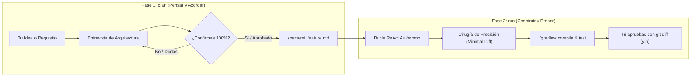

# Universal Agentic Loop & Spec-Driven Development Engine

Motor agéntico autónomo y desacoplado, diseñado para integrarse directamente en **Android Studio** (vía Terminal integrada o Gradle) y fácilmente extrapolable a cualquier otro proyecto de software.

---

## 1. Filosofía de Diseño: Dos Fases Claras

Para evitar frustraciones, descontrol de código o alucinaciones, el sistema separa estrictamente la **fase de pensamiento** de la **fase de construcción**:



### Reglas de Oro del Sistema:
1. **Gate de Confirmación Estricto (Fase 1):** El agente nunca da por cerrada una especificación por su cuenta. Dialoga contigo hasta que tú escribas `OK` o `APROBADO`.
2. **Cirugía de Precisión (Minimal Blast Radius) (Fase 2):** Ante un error de compilación o de pruebas, el agente tiene prohibido reescribir clases enteras. Solo localiza y parchea la función o línea directamente afectada, manteniendo el resto del código 100% intacto.
3. **Honestidad Activa (`ask_human`):** Si en mitad de la ejecución surge una ambigüedad de negocio o diseño, el agente pausa el bucle y te consulta directamente en la terminal.
4. **Control Humano Final (Human-in-the-Loop):** Ningún cambio se consolida a ciegas; siempre te muestra el `git diff` antes de guardar.

---

## 2. Configuración de Proveedores (Claude o Gemini)

El motor es agnóstico del modelo. Puedes utilizar **Claude 3.5 Sonnet** (vía Anthropic API) o **Gemini 2.5 Flash** (vía Google GenAI SDK).

Configura la clave en tu terminal de Android Studio:

```bash
# Para usar Claude 3.5 Sonnet (Recomendado para coding autónomo):
export ANTHROPIC_API_KEY="tu-clave-anthropic"

# Para usar Gemini:
export GEMINI_API_KEY="tu-clave-gemini"
```

---

## 3. Guía de Uso Diario desde Android Studio

Abre la pestaña **Terminal** (en la parte inferior de Android Studio) y utiliza los dos comandos:

### A. Fase 1: Entrevista y Creación de la Spec
```bash
python -m agents_dev plan "Quiero implementar el cálculo de balance negativo para alumnos con saldo a favor"
```
* El agente leerá `AGENTS.md` y `BUSINESS_RULES.md`, te hará preguntas para clarificar casos límite y redactará el borrador.
* Escribe tus respuestas o cambios en la terminal.
* Cuando estés completamente de acuerdo, escribe `OK` o `APROBADO`. La spec se guardará en `specs/calculo_balance_negativo.md`.

### B. Fase 2: Ejecución del Bucle Autónomo
```bash
# Opción A: Construir a partir de una spec aprobada
python -m agents_dev run --spec specs/calculo_balance_negativo.md

# Opción B: Ejecutar una tarea rápida o refactor puntual
python -m agents_dev run "Verifica que StudentRepositoryImpl cumple la separación de capas y compila con Gradle"

# Opción C: Forzar el proveedor deseado (Gemini o Claude)
python -m agents_dev --provider=gemini run --spec specs/calculo_balance_negativo.md

# Opción D: Seleccionar un modelo específico (ej. Gemini 2.5 Pro o Flash)
python -m agents_dev --provider=gemini --model=gemini-2.5-pro run "Refactorizar casos de uso"
```

> **Modelos recomendados:**
> - **Google Gemini:** `gemini-2.5-flash` (por defecto, ultra rápido y preciso) o `gemini-2.5-pro` (máxima capacidad de razonamiento).
> - **Anthropic Claude:** `claude-3-5-sonnet-20241022` o `claude-3-7-sonnet`.

Durante la ejecución, el agente:
* Inspeccionará código con `read_file`.
* Aplicará cambios quirúrgicos con `patch_file`.
* Validará la inyección de dependencias con `check_hilt_bindings`.
* Compilará y auto-corregirá errores con `./gradlew compileDebugKotlin`.
* Verificará los tests con `./gradlew test`.
* Te mostrará el `git diff` final y te pedirá `(y/n)` para conservar o revertir.

---

## 4. Arquitectura de Módulos

```text
agents_dev/
├── core/
│   ├── engine.py           # Bucle autónomo ReAct (while not finished)
│   ├── system_tools.py     # Herramientas del sistema: read_file, patch_file, run_command, list_files
│   ├── skill_tools.py      # Puente que conecta tus skills existentes (hilt_checker, etc.)
│   └── interactive.py      # Herramienta ask_human y aprobación git diff
├── providers/
│   ├── base.py             # Interfaz común BaseLLMProvider
│   ├── anthropic_provider.py # Conector nativo de Claude con Tool Use
│   └── gemini_provider.py    # Conector nativo de Gemini con Function Calling
├── planner/
│   └── spec_interviewer.py # Motor de entrevista y gate de confirmación de specs
├── specs/                  # Especificaciones (.md) generadas en el proyecto
├── cli.py                  # CLI unificado (plan | run)
└── __main__.py             # Permite ejecución con 'python -m agents_dev'
```

---

## 5. Guía de Extrapolación: Cómo llevarte este motor a otros proyectos

Este motor fue diseñado para ser **100% reutilizable** en cualquier otro repositorio (iOS con Swift, Web con React/Node, Backend con Go/Python, etc.):

1. **Copia las carpetas núcleo:**
   Copia `agents_dev/core/`, `agents_dev/providers/`, `agents_dev/planner/` y `cli.py` a tu nuevo proyecto.
2. **Adapta los comandos en `system_tools.py`:**
   En `run_command`, cambia `./gradlew` por los comandos de tu nuevo stack:
   * En iOS: `xcodebuild` o `swift test`.
   * En React/Node: `npm run build` y `npm test`.
   * En Python: `pytest`.
3. **Adapta tus guías:**
   Coloca en la raíz de tu nuevo proyecto sus directrices equivalentes a `AGENTS.md` o reglas de negocio.
4. **¡Listo!** Ya tienes un agente autónomo de desarrollo en tu nuevo proyecto.
