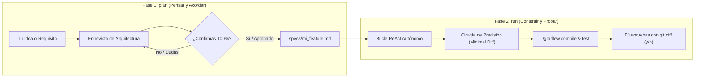

# Universal Agentic Loop & Spec-Driven Development Engine

Motor agéntico autónomo y desacoplado, diseñado para integrarse directamente en **Android Studio** (vía Terminal integrada o Gradle) y fácilmente extrapolable a cualquier otro proyecto de software (iOS, Web, Backend).

> [!TIP]
> **Guía Visual y Cheat Sheet de Comandos:** Para ver los diagramas de arquitectura detallados (`system_tools` vs `skill_tools`), el flujo de ejecución y todos los comandos posibles, consulta la [Guía de Arquitectura y Comandos](file:///Users/susanacordobaserrano/AndroidStudioProjects/HomeTutorPro/docs/AGENTIC_LOOP_ARCHITECTURE_AND_COMMANDS.md).

---

## 1. Filosofía de Diseño: Dos Fases Claras

Para evitar frustraciones, descontrol de código o alucinaciones, el sistema separa estrictamente la **fase de pensamiento** de la **fase de construcción**:



### Reglas de Oro del Sistema:
1. **Gate de Confirmación Estricto (Fase 1):** El agente nunca da por cerrada una especificación por su cuenta. Dialoga contigo en la terminal hasta que tú escribas explícitamente `OK` o `APROBADO`.
2. **Cirugía de Precisión (Minimal Blast Radius) (Fase 2):** Ante cualquier cambio o corrección de errores, el agente tiene terminantemente prohibido reescribir clases enteras. Solo localiza y parchea la función o bloque directamente afectado con `patch_file`, manteniendo el resto del código 100% intacto.
3. **Honestidad Activa (`ask_human`):** Si en mitad de la ejecución surge una ambigüedad de negocio o diseño, el agente pausa el bucle y te consulta directamente en la terminal.
4. **Control Humano Final (Human-in-the-Loop):** Ningún cambio se consolida a ciegas; siempre te muestra el `git diff` interactivo antes de decidir si conservar o descartar los cambios.

---

## 2. Requisitos y Configuración de Proveedores

El motor es agnóstico del modelo. Soporta **Google Gemini** (vía Google GenAI SDK con reintentos automáticos ante rate limits) y **Anthropic Claude** (vía Anthropic API).

### Paso 1: Activar entorno virtual e instalar dependencias
```bash
# Activa el entorno virtual con Python 3.11 del proyecto:
source agents_dev/.venv_agente/bin/activate

# Instala dependencias:
pip install -r agents_dev/requirements.txt
# o instalar individualmente:
pip install google-genai anthropic
```

### Paso 2: Configurar las variables de entorno
Configura tu clave en tu terminal o agrégala a tu `~/.zshrc`:

```bash
# Para Google Gemini (Clave universal de Google AI Studio):
export GEMINI_API_KEY="tu-clave-gemini-AIzaSy..."

# Para Anthropic Claude (Opcional):
export ANTHROPIC_API_KEY="tu-clave-anthropic-sk-ant-..."

# (Opcional) Sobrescribir el modelo por defecto:
export GEMINI_MODEL="gemini-3.1-flash-lite"          # o "gemini-2.5-pro"
export ANTHROPIC_MODEL="claude-3-5-sonnet-20241022"
```

> [!NOTE]
> **Sobre las versiones de Gemini:** Google está migrando las versiones anteriores a la nueva serie `gemini-3.1-flash-lite`, la cual ofrece mayor eficiencia, menor consumo de tokens y soporte mejorado para llamadas a herramientas (*tool-calling*). Tu clave de Google AI Studio es universal para todas ellas.

---

## 3. Guía de Uso Diario desde Android Studio

Abre la pestaña **Terminal** (en la parte inferior de Android Studio) y utiliza los dos comandos:

### A. Fase 1: Entrevista y Creación de la Spec (`plan`)
```bash
python3 -m agents_dev plan "Quiero implementar el cálculo de balance negativo para alumnos con saldo a favor"
```
* El agente leerá `AGENTS.md` y `BUSINESS_RULES.md`, te hará preguntas para clarificar casos límite y redactará el borrador.
* Responde sus preguntas en el diálogo interactivo.
* Cuando estés completamente de acuerdo, escribe `OK` o `APROBADO`. La spec se guardará en `specs/<nombre_feature>.md`.

*Para usar un modelo más potente en el diseño de arquitectura:*
```bash
python3 -m agents_dev --provider gemini --model gemini-2.5-pro plan "Sistema de notificaciones"
```

### B. Fase 2: Ejecución del Bucle Autónomo (`run`)
```bash
# Opción 1: Construir a partir de una spec aprobada
python3 -m agents_dev run --spec specs/calculo_balance_negativo.md

# Opción 2: Ejecutar una tarea rápida o refactor puntual sin spec previa
python3 -m agents_dev run "Verifica que StudentRepositoryImpl cumple la separación de capas y compila con Gradle"

# Opción 3: Forzar proveedor y modelo específico
python3 -m agents_dev --provider gemini --model gemini-2.5-pro run --spec specs/calculo_balance_negativo.md
python3 -m agents_dev --provider claude run --spec specs/calculo_balance_negativo.md
```

#### ¿Qué ocurre durante la ejecución de Fase 2?
1. Se muestra en consola el proveedor y modelo activo (ej. `🤖 Proveedor activo: GeminiProvider | Modelo: gemini-3.1-flash-lite`).
2. El agente inspecciona el código con `read_file` y `list_files`.
3. Aplica **parches quirúrgicos** con `patch_file` respetando Clean Architecture.
4. Valida la inyección de dependencias con `check_hilt_bindings` y genera tests con `scaffold_test`.
5. Ejecuta `./gradlew compileDebugKotlin` y `./gradlew test` en bucle cerrado auto-corrigiendo cualquier fallo.
6. Si tiene dudas, te pregunta con `ask_human`.
7. Al terminar, muestra el `git diff` final y te pide `(y/n)` para conservar o revertir.

---

## 4. Verificación y Tests del Motor

Puedes verificar que todos los componentes y herramientas del bucle agéntico funcionan correctamente ejecutando:

```bash
python3 -m unittest discover agents_dev/tests
```

Los tests verifican:
- Ciclo de vida y exactitud del parche quirúrgico (`patch_file`).
- Fallos controlados ante bloques ambiguos o no encontrados.
- Ejecución de comandos del sistema.
- Selección e instanciación correcta de proveedores (`gemini`, `claude`) y modelos personalizados.

---

## 5. Arquitectura de Módulos

```text
agents_dev/
├── ci/
│   └── pr_review.py            # Único ejecutor de CI: analiza PRs con 5 skills y aplica guardrails
├── core/
│   ├── engine.py               # Bucle autónomo ReAct con auto-reparación de compilación/tests
│   ├── system_tools.py         # Herramientas de sistema: read_file, patch_file, run_command, list_files
│   ├── skill_tools.py          # Puente que expone tus skills Android al LLM
│   └── interactive.py          # Herramienta ask_human y pasarela de confirmación con git diff
├── planner/
│   └── spec_interviewer.py     # Motor de entrevista y gate estricto de aprobación de specs
├── providers/
│   ├── base.py                 # Interfaz universal BaseLLMProvider, LLMResponse, ToolCall
│   ├── gemini_provider.py      # Conector nativo de Google Gemini (gemini-3.1-flash-lite)
│   └── anthropic_provider.py   # Conector nativo de Anthropic Claude con Tool Use
├── skills/                     # TUS SKILLS ESENCIALES:
│   ├── architecture_auditor.py # 1. Auditoría de Arquitectura
│   ├── security_scanner.py     # 2. Escáner de Seguridad
│   ├── test_generator.py       # 3. Diseño de Tests
│   ├── kdoc_specialist.py      # 4. Auditoría KDoc
│   ├── refactor_assistant.py   # 5. Asistente de Refactorización
│   ├── hilt_checker.py         # 6. Validador rápido local de inyección Hilt
│   ├── test_scaffolder.py      # 7. Generador físico de tests JUnit 5 en disco
│   ├── config.py               # Cliente local de IA (ignorado en git)
│   └── config.example.py       # Plantilla segura de configuración
├── specs/                      # Especificaciones (.md) generadas en el proyecto
├── tests/                      # Suite de pruebas unitarias del motor agéntico
├── cli.py                      # CLI unificado (plan | run) con soporte para --provider y --model
├── run.sh                      # Lanzador con activación automática de entorno virtual
├── requirements.txt            # Dependencias Python requeridas (google-genai, anthropic, PyGithub)
└── __main__.py                 # Punto de entrada para ejecución modular: 'python3 -m agents_dev'
```

---

## 6. Guía de Extrapolación: Cómo llevarte este motor a otros proyectos

Este motor fue diseñado para ser **100% reutilizable** en cualquier otro repositorio (iOS con Swift, Web con React/Node, Backend con Go/Python, etc.):

1. **Copia la carpeta `agents_dev/`:**
   Copia `agents_dev/core/`, `agents_dev/providers/`, `agents_dev/planner/`, `cli.py` y `__main__.py` a tu nuevo proyecto.
2. **Adapta los comandos en `core/system_tools.py`:**
   En `run_command`, ajusta los comandos de compilación y prueba de tu nuevo stack:
   * **iOS (Xcode):** `xcodebuild -scheme MiApp test` o `swift test`.
   * **Web (React/Node/Vue):** `npm run build` y `npm test`.
   * **Python:** `pytest`.
   * **Rust:** `cargo test`.
3. **Adapta tus reglas de proyecto:**
   Crea o ajusta el archivo equivalente a `AGENTS.md` o `BUSINESS_RULES.md` en la raíz de tu nuevo proyecto para que el agente aprenda las convenciones locales.
4. **¡Listo!** Tienes un agente de desarrollo autónomo completamente operativo.

---

## 7. Solución de Problemas Comunes (Troubleshooting)

### `ModuleNotFoundError: No module named 'google'`
- **Causa:** No tienes instalada la biblioteca oficial del SDK de Gemini en el entorno de Python que estás ejecutando.
- **Solución:** Ejecuta `pip install google-genai` (o `pip3 install -r agents_dev/requirements.txt`).

### `ValueError: GEMINI_API_KEY no está configurada`
- **Causa:** La variable de entorno no está accesible en la sesión actual de la terminal.
- **Solución:** Asegúrate de ejecutar `export GEMINI_API_KEY="tu-clave"` en tu terminal o añadirla a tu `~/.zshrc`.

### `Rate Limit (429) o RESOURCE_EXHAUSTED`
- **Causa:** Límites de peticiones por minuto en la API gratuita.
- **Solución:** El proveedor `GeminiProvider` incluye reintentos automáticos con espera exponencial (15s, 30s...). Si persiste, puedes usar `--model gemini-2.5-flash` (más ligero) o alternar a Claude con `--provider claude`.
