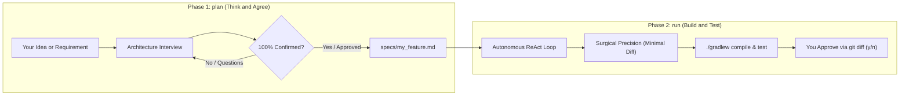

# Universal Agentic Loop & Spec-Driven Development Engine

Autonomous, decoupled agentic engine designed to integrate directly into **Android Studio** (via integrated Terminal or Gradle) and easily extrapolatable to any other software project (iOS, Web, Backend).

> [!TIP]
> **Master Guide and Command Cheat Sheet:** For the complete educational guide, architecture diagrams (`system_tools` vs `skill_tools`), execution flow, and all available commands, see the [Master Guide to the Agentic Loop](file:///Users/susanacordobaserrano/AndroidStudioProjects/HomeTutorPro/docs/GUIA_MAESTRA_BUCLE_AGENTICO.md).

---

## 1. Design Philosophy: Two Clear Phases

To avoid frustration, uncontrolled code drift, or hallucinations, the system strictly separates the **thinking phase** from the **building phase**:



### Golden Rules of the System:
1. **Strict Confirmation Gate (Phase 1):** The agent never marks a specification as final on its own. It dialogues with you in the terminal until you explicitly type `OK` or `APPROVED`.
2. **Surgical Precision (Minimal Blast Radius) (Phase 2):** When making changes or fixing errors, the agent is strictly prohibited from rewriting whole classes. It locates and patches only the directly affected function or block using `patch_file`, leaving the rest of the code 100% intact.
3. **Active Honesty (`ask_human`):** If any business or architectural ambiguity arises during execution, the agent pauses the loop and consults you directly in the terminal.
4. **Final Human Control (Human-in-the-Loop):** No changes are committed blindly; the agent always displays the interactive `git diff` before asking whether to keep or discard the changes.

---

## 2. Requirements and Provider Configuration

The engine is model-agnostic. It supports **Google Gemini** (via the Google GenAI SDK with automatic exponential backoff retries on rate limits) and **Anthropic Claude** (via Anthropic API).

### Step 1: Activate virtual environment and install dependencies
```bash
# Activate the virtual environment with project's Python 3.11:
source agents_dev/.venv_agente/bin/activate

# Install dependencies:
pip install -r agents_dev/requirements.txt
# or install individually:
pip install google-genai anthropic PyGithub
```

### Step 2: Configure environment variables
Configure your API key in your terminal or add it to `~/.zshrc`:

```bash
# For Google Gemini (Universal Google AI Studio key):
export GEMINI_API_KEY="your-gemini-key-AIzaSy..."

# For Anthropic Claude (Optional):
export ANTHROPIC_API_KEY="your-anthropic-key-sk-ant-..."

# (Optional) Override default models:
export GEMINI_MODEL="gemini-3.1-flash-lite"          # or "gemini-2.5-pro"
export ANTHROPIC_MODEL="claude-3-5-sonnet-20241022"
```

> [!NOTE]
> **Gemini Versions:** Google is transitioning models to the `gemini-3.1-flash-lite` series, which offers higher efficiency, lower token consumption, and superior tool-calling support. Your Google AI Studio key is universal across all versions.

---

## 3. Daily Usage Guide from Android Studio

Open the **Terminal** tab in Android Studio and use the two main commands:

### A. Phase 1: Interview and Spec Creation (`plan`)
```bash
python3 -m agents_dev plan "I want to implement negative balance calculation for students with credit"
```
* The agent reads `AGENTS.md` and `BUSINESS_RULES.md`, asks questions to clarify edge cases, and drafts the technical spec.
* Answer its questions in the interactive terminal dialogue.
* When completely satisfied, type `OK` or `APPROVED`. The spec is saved to `specs/<feature_name>.md`.

*To use a larger model for complex architectural design:*
```bash
python3 -m agents_dev --provider gemini --model gemini-2.5-pro plan "Notification System"
```

### B. Phase 2: Autonomous Loop Execution (`run`)
```bash
# Option 1: Build from an approved spec
python3 -m agents_dev run --spec specs/negative_balance_calculation.md

# Option 2: Execute a targeted task or quick refactor without prior spec
python3 -m agents_dev run "Verify that StudentRepositoryImpl obeys layer boundaries and compiles with Gradle"

# Option 3: Force specific provider and model
python3 -m agents_dev --provider gemini --model gemini-2.5-pro run --spec specs/negative_balance_calculation.md
python3 -m agents_dev --provider claude run --spec specs/negative_balance_calculation.md
```

#### What happens during Phase 2 execution?
1. The active provider and model are displayed in the console (e.g. `🤖 Active Provider: GeminiProvider | Model: gemini-3.1-flash-lite`).
2. The agent inspects code using `read_file` and `list_files`.
3. It applies **surgical patches** using `patch_file` respecting Clean Architecture.
4. It validates dependency injection with `check_hilt_bindings` and generates tests with `scaffold_test`.
5. It runs `./gradlew compileDebugKotlin` and `./gradlew test` in a self-healing loop, auto-correcting any compilation or test failures.
6. If ambiguities arise, it asks you using `ask_human`.
7. When finished, it displays the final `git diff` and prompts for `(y/n)` to keep or revert.

---

## 4. Verification and Engine Tests

You can verify that all agent loop components and tools are working properly by running:

```bash
python3 -m unittest discover agents_dev/tests
```

The tests verify:
- Lifecycle and exactness of surgical patching (`patch_file`).
- Controlled failures for ambiguous or missing search blocks.
- System command execution.
- Hilt DI binding checks and scaffolding.
- Context engine layer classification and boundaries.
- Correct provider instantiation (`gemini`, `claude`) and custom models.

---

## 5. Module Architecture

```text
agents_dev/
├── ci/
│   └── pr_review.py            # CI Executor: reviews PRs with unified_reviewer and posts clean reports
├── core/
│   ├── engine.py               # Autonomous ReAct loop with compilation/test self-healing
│   ├── system_tools.py         # System tools: read_file, patch_file, write_new_file, run_command, list_files
│   ├── skill_tools.py          # Bridge exposing Android skills as LLM tools
│   └── interactive.py          # ask_human tool and interactive git diff confirmation gateway
├── planner/
│   └── spec_interviewer.py     # Spec interview engine and strict approval gate
├── providers/
│   ├── base.py                 # Universal BaseLLMProvider, LLMResponse, ToolCall interface
│   ├── gemini_provider.py      # Native Google Gemini connector with exponential backoff
│   └── anthropic_provider.py   # Native Anthropic Claude connector with Tool Use
├── skills/                     # SKILLS & STANDARDS ENGINE:
│   ├── PROJECT_STANDARDS.md    # 📋 Single source of truth: Layer boundaries, OWASP, KDoc, Quality
│   ├── context_engine.py       # 🧠 Component classifier and anti-hallucination shielding
│   ├── unified_reviewer.py     # ⚡ Surgical all-in-one review (1 call per file for CI)
│   ├── architecture_auditor.py # 1. Architecture Audit skill
│   ├── security_scanner.py     # 2. Security Scanner skill
│   ├── test_generator.py       # 3. Test Design skill
│   ├── kdoc_specialist.py      # 4. KDoc Audit skill
│   ├── refactor_assistant.py   # 5. Refactor Analysis skill
│   ├── hilt_checker.py         # 6. Hilt Dependency Injection verification skill
│   ├── test_scaffolder.py      # 7. JUnit 5 test scaffolder on disk
│   ├── config.py               # Local AI client configuration (gitignored)
│   └── config.example.py       # Safe configuration template
├── specs/                      # Generated technical specifications (.md)
├── tests/                      # Unit test suite for the agent engine (15 tests)
├── cli.py                      # Unified CLI (plan | run | review) with --provider and --model
├── run.sh                      # Launcher with automatic virtual environment activation
├── requirements.txt            # Required Python dependencies (google-genai, anthropic, PyGithub)
└── __main__.py                 # Entry point for modular execution: 'python3 -m agents_dev'
```

---

## 6. Project Extrapolation Guide: Adapting to Other Stacks

This engine was designed to be **100% reusable** in any other repository (iOS with Swift, Web with React/Node, Backend with Go/Python, etc.):

1. **Copy the `agents_dev/` folder:**
   Copy `agents_dev/core/`, `agents_dev/providers/`, `agents_dev/planner/`, `cli.py`, and `__main__.py` to your new project.
2. **Adapt commands in `core/system_tools.py`:**
   In `run_command`, adjust compilation and test commands for your new stack:
   * **iOS (Xcode):** `xcodebuild -scheme MyApp test` or `swift test`.
   * **Web (React/Node/Vue):** `npm run build` and `npm test`.
   * **Python:** `pytest`.
   * **Rust:** `cargo test`.
3. **Adapt project guidelines:**
   Create or adjust the equivalent of `AGENTS.md` or `BUSINESS_RULES.md` in the root of your new project so the agent learns local conventions.
4. **Ready!** You now have a fully operational autonomous development agent.

---

## 7. Troubleshooting

### `ModuleNotFoundError: No module named 'google'`
- **Cause:** The official Gemini SDK library is not installed in your active Python environment.
- **Solution:** Run `pip install google-genai` (or `pip3 install -r agents_dev/requirements.txt`).

### `ValueError: GEMINI_API_KEY is not configured`
- **Cause:** The environment variable is not accessible in the current terminal session.
- **Solution:** Run `export GEMINI_API_KEY="your-key"` in your terminal or add it to `~/.zshrc`.

### `Rate Limit (429) or RESOURCE_EXHAUSTED`
- **Cause:** Requests-per-minute limits on the free API tier.
- **Solution:** `GeminiProvider` includes automatic retries with exponential backoff. If persistent, switch to `--model gemini-3.1-flash-lite` or use Claude with `--provider claude`.
