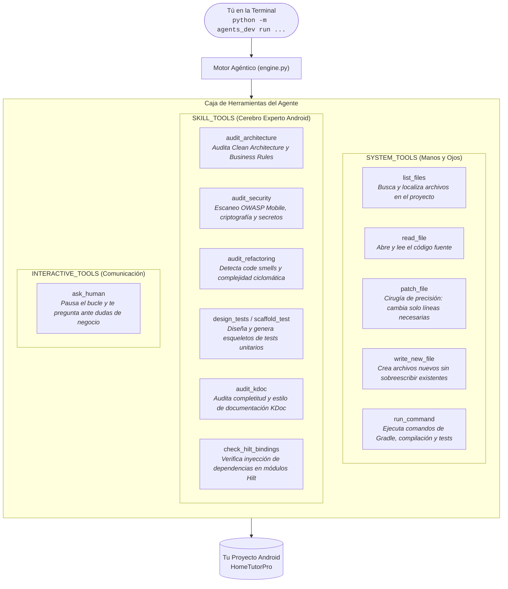
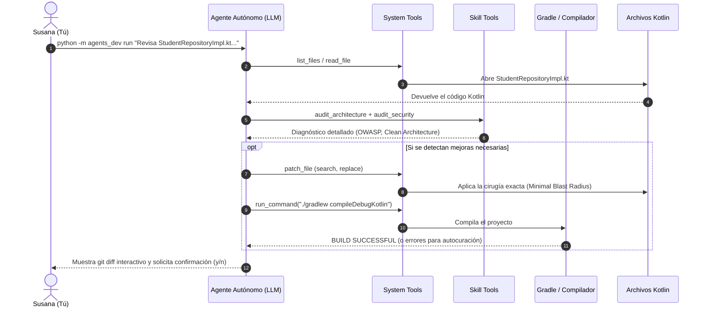
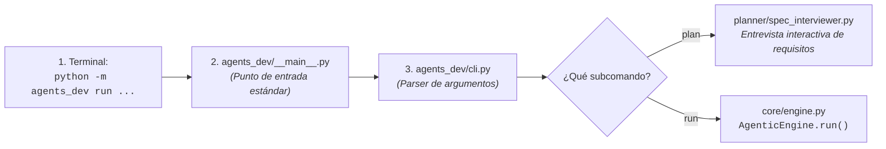

# 🤖 Arquitectura del Universal Agentic Loop & Guía Completa de Comandos

Este documento explica de forma visual y pedagógica cómo funciona el motor agéntico de **HomeTutorPro** (`agents_dev/`), cómo cooperan sus herramientas y todos los comandos disponibles para ejecutarlo desde la terminal de Android Studio.

---

## 1. 🧩 La Caja de Herramientas: `system_tools` vs `skill_tools`

El agente no tiene manos ni ojos para ver Android Studio; interactúa con el proyecto a través de **herramientas (*tools*)**. Para mantener el código modular y limpio, las herramientas se dividen en tres categorías complementarias:



### Tabla Comparativa de Responsabilidades

| Categoría | Módulo | Función Principal | ¿Qué pasaría si no existiera? |
| :--- | :--- | :--- | :--- |
| **`SYSTEM_TOOLS`** | [`system_tools.py`](file:///Users/susanacordobaserrano/AndroidStudioProjects/HomeTutorPro/agents_dev/core/system_tools.py) | **Manos y Ojos:** Interactúa físicamente con el disco duro y el compilador (leer, parchear, compilar). | El agente sería un "sabio ciego y manco": sabría qué corregir pero no podría abrir ni tocar ningún archivo. |
| **`SKILL_TOOLS`** | [`skill_tools.py`](file:///Users/susanacordobaserrano/AndroidStudioProjects/HomeTutorPro/agents_dev/core/skill_tools.py) | **Cerebro Consultor:** Evalúa calidad, arquitectura, OWASP Mobile, documentación y contratos Hilt. | El agente sabría editar archivos, pero no tendría tus estándares de calidad ni sabría si introduce vulnerabilidades. |
| **`INTERACTIVE_TOOLS`** | [`interactive.py`](file:///Users/susanacordobaserrano/AndroidStudioProjects/HomeTutorPro/agents_dev/core/interactive.py) | **Voz y Control:** Pregunta al desarrollador y muestra el `git diff` final para aprobación (`y/n`). | El agente trabajaría a ciegas y aplicaría cambios sin tu supervisión directa. |

---

## 2. ⚡ ¿Cómo Colaboran en un Caso Real?

Cuando ejecutas un objetivo como:
> `python -m agents_dev run "Revisa StudentRepositoryImpl.kt, ejecuta audit_security y audit_architecture y si detectas algo corrígelo con patch_file"`

El flujo de ejecución sigue exactamente este diagrama de secuencia:



---

## 3. 🚦 La Cadena de Arranque Interna de Python

¿Por qué al escribir `python -m agents_dev run ...` el sistema sabe que debe arrancar `engine.py`?



1. **`python -m agents_dev`:** Por estándar de Python, el flag `-m` busca el archivo [`__main__.py`](file:///Users/susanacordobaserrano/AndroidStudioProjects/HomeTutorPro/agents_dev/__main__.py) dentro de la carpeta `agents_dev/`.
2. **`__main__.py`:** Invoca la función `main()` de [`cli.py`](file:///Users/susanacordobaserrano/AndroidStudioProjects/HomeTutorPro/agents_dev/cli.py).
3. **`cli.py`:** Utiliza `argparse` para leer la palabra clave (`plan` o `run`) y los parámetros (`--provider`, `--model`, `--spec`, `--iterations`).
4. **Instanciación:** Si se ejecutó `run`, instancia `AgenticEngine(provider=..., max_iterations=...)` y comienza el bucle ReAct.

---

## 4. 📖 Referencia Completa de Comandos (Cheat Sheet)

### Paso Previo Obligatorio: Activar el Entorno
Ejecuta siempre esto en tu terminal de Android Studio antes de lanzar comandos:
```bash
source agents_dev/.venv_agente/bin/activate
```

---

### Fase 1: Planificación y Entrevista de Especificaciones (`plan`)
Úsalo cuando tengas una idea nueva o cambio complejo y quieras que el agente te entreviste para pulir los requisitos antes de escribir código:

```bash
# 1. Entrevista estándar (con Gemini 3.1 Flash-Lite por defecto):
python -m agents_dev plan "Añadir un sistema de caché offline para los estudiantes en Room"

# 2. Entrevista con Gemini 2.5 Pro (recomendado para arquitectura compleja o rediseños):
python -m agents_dev --provider=gemini --model=gemini-2.5-pro plan "Refactorizar la sincronización de Firestore para soportar conflictos multi-dispositivo"

# 3. Entrevista con Claude 3.5 / 3.7 Sonnet:
python -m agents_dev --provider=claude plan "Diseñar el flujo de suscripciones in-app con Google Play Billing"
```
> **Nota:** La entrevista genera preguntas en la terminal. El archivo `.md` de especificación en `specs/` **solo se guardará cuando escribas explícitamente `OK` o `APROBADO`**.

---

### Fase 2: Ejecución del Bucle Autónomo (`run`)

#### A. Ejecución directa por objetivo (ideal para refactorizaciones y revisiones rápidas):
```bash
# 1. Auditoría completa de seguridad y arquitectura de una clase:
python -m agents_dev run "Revisa StudentRepositoryImpl.kt, ejecuta audit_security y audit_architecture para certificar que está limpio y si detectas algo mejorable corrígelo con patch_file"

# 2. Creación de tests unitarios asistida:
python -m agents_dev run "Diseña con design_tests y genera con scaffold_test las pruebas unitarias para AuthRepositoryImpl.kt"

# 3. Verificación de inyección de dependencias Hilt:
python -m agents_dev run "Ejecuta check_hilt_bindings para todas las interfaces de domain/repository/ y reporta si falta algún binding"
```

#### B. Ejecución a partir de una Especificación Aprobada (`--spec`):
```bash
# 1. Construir a partir de una spec previamente validada:
python -m agents_dev run --spec specs/mi_feature_aprobada.md

# 2. Ejecutar con Gemini 2.5 Pro para máxima potencia de razonamiento:
python -m agents_dev --provider=gemini --model=gemini-2.5-pro run --spec specs/mi_feature_aprobada.md

# 3. Ejecutar con Claude 3.7 Sonnet:
python -m agents_dev --provider=claude --model=claude-3-7-sonnet run --spec specs/mi_feature_aprobada.md
```

#### C. Control de Iteraciones y Parámetros Avanzados:
```bash
# Limitar a 10 iteraciones para tareas cortas:
python -m agents_dev run "Audita KDoc en SueAgentImpl.kt" --iterations 10

# Ampliar a 40 iteraciones para refactorizaciones grandes:
python -m agents_dev run --spec specs/refactor_sync.md --iterations 40
```

---

### Verificación y Tests del Motor Agéntico
Para comprobar que todas las herramientas y conectores están en verde:
```bash
PYTHONPATH=agents_dev python -m unittest discover agents_dev/tests
```

### Ejecutar la Auditoría de Seguridad Directamente
Si solo deseas escanear un archivo sin iniciar el bucle agéntico:
```bash
python -c "import sys; sys.path.insert(0, 'agents_dev/skills'); import security_scanner; print(security_scanner.run_security_scan('app/src/main/java/com/devsusana/hometutorpro/data/repository/StudentRepositoryImpl.kt'))"
```
