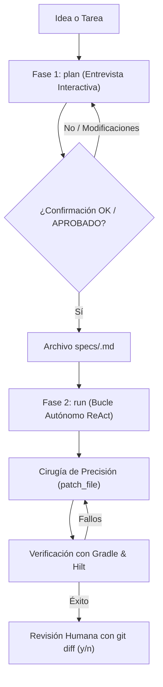

# 🔄 Universal Agentic Loop & Spec-Driven Development Guide

**Guía Maestra y Estado del Sistema de Desarrollo Autónomo Integrado en Android Studio**

---

## 1. 📌 Resumen Ejecutivo del Estado del Sistema

El proyecto **HomeTutorPro** cuenta con un motor agéntico universal (`agents_dev/`) integrado directamente en la terminal de Android Studio. Este motor permite desarrollar, refactorizar y verificar código de forma autónoma con **Google Gemini (2.5 Flash / 2.5 Pro)** o **Anthropic Claude (3.5 / 3.7 Sonnet)**, manteniendo siempre al desarrollador con el control final.

### Estado de Componentes:
| Componente | Estado | Ubicación | Descripción |
| :--- | :---: | :--- | :--- |
| **CLI Unificado** | ✅ Operativo | [`agents_dev/cli.py`](file:///Users/susanacordobaserrano/AndroidStudioProjects/HomeTutorPro/agents_dev/cli.py) | Soporta subcomandos `plan` y `run`, flags `--provider` y `--model`. |
| **Punto de Entrada Modular** | ✅ Operativo | [`agents_dev/__main__.py`](file:///Users/susanacordobaserrano/AndroidStudioProjects/HomeTutorPro/agents_dev/__main__.py) | Permite invocación con `python3 -m agents_dev` desde cualquier carpeta. |
| **Entrevistador de Specs** | ✅ Operativo | [`agents_dev/planner/spec_interviewer.py`](file:///Users/susanacordobaserrano/AndroidStudioProjects/HomeTutorPro/agents_dev/planner/spec_interviewer.py) | Gate estricto: requiere confirmación verbal (`OK` o `APROBADO`) para persistir la spec. |
| **Bucle Autónomo ReAct** | ✅ Operativo | [`agents_dev/core/engine.py`](file:///Users/susanacordobaserrano/AndroidStudioProjects/HomeTutorPro/agents_dev/core/engine.py) | Iteración multi-turno con auto-reparación de compilación y tests con Gradle. |
| **Cirugía de Precisión** | ✅ Operativo | [`agents_dev/core/system_tools.py`](file:///Users/susanacordobaserrano/AndroidStudioProjects/HomeTutorPro/agents_dev/core/system_tools.py) | Herramienta `patch_file` con radio de impacto mínimo (prohibido reescribir clases enteras). |
| **Skills de Android** | ✅ Operativo | [`agents_dev/skills/`](file:///Users/susanacordobaserrano/AndroidStudioProjects/HomeTutorPro/agents_dev/skills/) | 5 skills cognitivas (Arquitectura, Seguridad, Tests, KDoc, Refactor) + Hilt Checker + Test Scaffolder. |
| **CI Unificada en GitHub** | ✅ Operativo | [`agents_dev/ci/pr_review.py`](file:///Users/susanacordobaserrano/AndroidStudioProjects/HomeTutorPro/agents_dev/ci/pr_review.py) | Un único script para análisis de PRs y bloqueo estricto ante fallos críticos (Guardrails). |
| **Proveedor Google Gemini** | ✅ Operativo | [`agents_dev/providers/gemini_provider.py`](file:///Users/susanacordobaserrano/AndroidStudioProjects/HomeTutorPro/agents_dev/providers/gemini_provider.py) | Manejo de reintentos exponenciales ante error 429 (`RESOURCE_EXHAUSTED`). |
| **Proveedor Anthropic** | ✅ Operativo | [`agents_dev/providers/anthropic_provider.py`](file:///Users/susanacordobaserrano/AndroidStudioProjects/HomeTutorPro/agents_dev/providers/anthropic_provider.py) | Tool-use nativo para Claude 3.5 Sonnet / 3.7 Sonnet. |
| **Suite de Tests del Motor** | ✅ 100% Passing | [`agents_dev/tests/`](file:///Users/susanacordobaserrano/AndroidStudioProjects/HomeTutorPro/agents_dev/tests/) | 4 tests unitarios verificando herramientas y resolución de modelos. |

---

## 2. 🧠 Aclaración sobre Modelos y Claves de API

### Tu Clave de Gemini es Universal
La API Key de Google AI Studio (`AIzaSy...`) configurada en tu entorno **es válida para todos los modelos de Gemini**. No necesitas generar claves distintas para cambiar de versión.

### Catálogo de Modelos Oficiales:
* **`gemini-3.1-flash-lite` (Por defecto):** El modelo oficial actual recomendado por Google para migración, optimizado para alta eficiencia, baja latencia y function calling en bucles de desarrollo.
* **`gemini-2.5-pro`:** Recomendado cuando se requiere razonamiento profundo para diseñar arquitecturas complejas o resolver dependencias enrevesadas.
* **`claude-3-5-sonnet-20241022` / `claude-3-7-sonnet`:** El referente de Anthropic para programación agéntica.

---

## 3. 🚀 Guía Rápida de Instalación y Uso

### Prerrequisitos
Activa el entorno virtual del proyecto (Python 3.11) e instala las dependencias:
```bash
# 1. Activar entorno virtual de Python 3.11:
source agents_dev/.venv_agente/bin/activate

# 2. Instalar dependencias:
pip install -r agents_dev/requirements.txt
```

Verifica que el motor funciona ejecutando su suite de pruebas:
```bash
python3 -m unittest discover agents_dev/tests
```

### Configuración de Variables de Entorno (en terminal o `~/.zshrc`)
```bash
# Obligatoria para Gemini:
export GEMINI_API_KEY="AIzaSy..."

# Obligatoria si usas Claude:
export ANTHROPIC_API_KEY="sk-ant-..."

# Opcional (sobrescribir modelo por defecto):
export GEMINI_MODEL="gemini-3.1-flash-lite"
```

---

## 4. 🛠️ Flujo Diario de Desarrollo en 2 Fases



### Fase 1: Entrevista y Creación de la Spec (`plan`)
Antes de tocar una sola línea de código, interactúa con el agente para definir claramente los requisitos:
```bash
# Ejemplo estándar:
python3 -m agents_dev plan "Soporte para edición de tarifas y mudanzas de alumnos"

# Con modelo Pro para diseño complejo:
python3 -m agents_dev --provider gemini --model gemini-2.5-pro plan "Soporte para edición de tarifas"
```
* El agente lee automáticamente [`AGENTS.md`](file:///Users/susanacordobaserrano/AndroidStudioProjects/HomeTutorPro/AGENTS.md) y [`BUSINESS_RULES.md`](file:///Users/susanacordobaserrano/AndroidStudioProjects/HomeTutorPro/BUSINESS_RULES.md).
* Te hace preguntas sobre casos límite, transaccionalidad y contratos de repositorios.
* **El proceso solo finaliza cuando escribes `OK` o `APROBADO`**. La especificación queda registrada en `specs/<nombre_feature>.md`.

---

### Fase 2: Ejecución del Bucle Autónomo (`run`)
Una vez acordada la spec, el agente construye la solución:
```bash
# Construir desde una spec aprobada:
python3 -m agents_dev run --spec specs/nombre_feature.md

# Tarea de corrección rápida sin spec:
python3 -m agents_dev run "Corrige la inyección de StudentDao en StudentRepositoryImpl"

# Forzando modelo específico:
python3 -m agents_dev --provider gemini --model gemini-2.5-pro run --spec specs/nombre_feature.md
```

#### Garantías de Ejecución:
1. **Minimal Blast Radius:** El agente solo parchea los bloques exactos con `patch_file`. Si una clase tiene 300 líneas y el error está en 3, las otras 297 no se modifican.
2. **Auto-reparación Gradle:** Ejecuta `./gradlew compileDebugKotlin` y `./gradlew test` tras cada cambio, corrigiendo iterativamente cualquier error que el compilador reporte.
3. **Honestidad Activa (`ask_human`):** Si detecta una ambigüedad durante la construcción, pausa la ejecución y te pregunta por consola.
4. **Puerta de Aprobación Final:** Al terminar, te muestra el `git diff` interactivo y te solicita `(y/n)` para conservar o revertir los cambios.

---

## 5. 📂 Documentos del Proyecto Relacionados

* [`AGENTS.md`](file:///Users/susanacordobaserrano/AndroidStudioProjects/HomeTutorPro/AGENTS.md): Reglas de arquitectura Kotlin/Compose y directrices de desarrollo (Sección 11 dedicada al bucle agéntico).
* [`agents_dev/README.md`](file:///Users/susanacordobaserrano/AndroidStudioProjects/HomeTutorPro/agents_dev/README.md): Documentación técnica del motor y guía paso a paso para extrapolarlo a proyectos iOS, Web o Backend.
* [`BUSINESS_RULES.md`](file:///Users/susanacordobaserrano/AndroidStudioProjects/HomeTutorPro/BUSINESS_RULES.md): Especificaciones de negocio y dominio pedagógico de HomeTutorPro.
* [`docs/ON_DEVICE_AI_AND_RAG_ARCHITECTURE.md`](file:///Users/susanacordobaserrano/AndroidStudioProjects/HomeTutorPro/docs/ON_DEVICE_AI_AND_RAG_ARCHITECTURE.md): Arquitectura de SUE, la IA local embebida en el dispositivo móvil.
